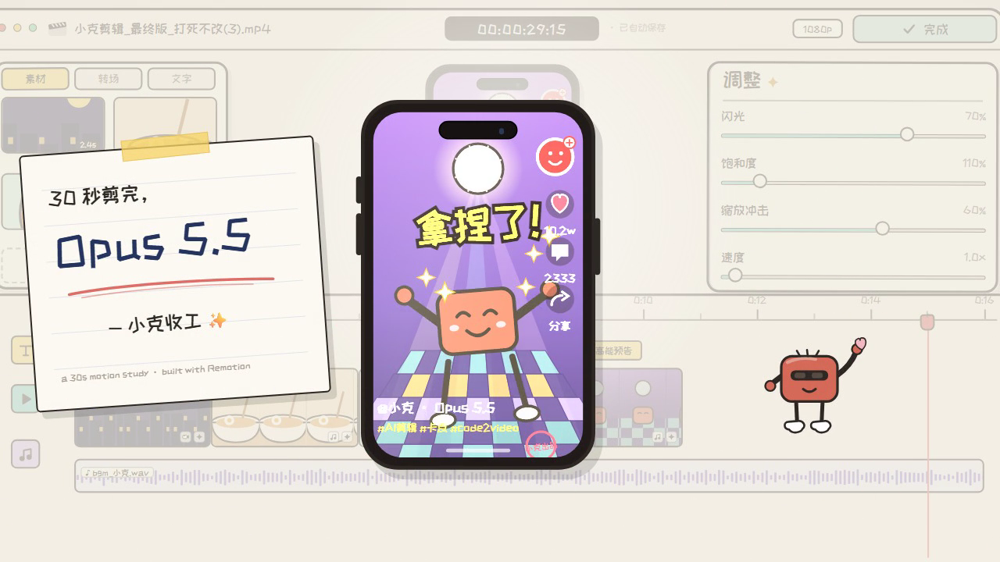

# Claude Edit Motion · 小克剪辑

A 30-second Remotion recreation of a hand-drawn video-editor interface: a tiny red director drags clips, deletes a boring take, applies a transition, tunes the grade, and exports a vertical video.



This is an intentionally re-authored homage, not a pixel-for-pixel copy. The reference is a 30s hand-drawn screen recording; because no project assets were supplied, every frame here is rebuilt from code — UI chrome, clip thumbnails, phone scenes, mascot, typography, camera moves, and the soundtrack.

## What is reproduced

- Terminal intro typing `const 剪辑软件 = 小克.写代码()` before the editor springs open.
- Hand-drawn editor shell: window bar, media / transition / text tabs, phone preview, adjustment sliders, timeline and audio bed.
- Four SVG scene libraries: night city, ramen close-up, shiba reaction, disco mascot.
- Mascot choreography: walk-in with dust, drag clips, delete a take, point at a transition, press `Ctrl+Z`, tune the grade, stretch an arm to Export, and pose in sunglasses for the end card.
- Camera pushes and pulls, speech bubbles (`这段在发呆 zzz`, `拜拜~`, `哐当!`, `稳了`), sparkles, confetti, and a polaroid end card.
- An original 120 BPM synth bed with cartoon SFX, generated from code.

## Specs

| | |
|---|---|
| Resolution | 1280 × 720 |
| Frame rate | 30 fps |
| Duration | 900 frames / 30.0 s |
| Stack | Remotion 4.0.537, React 19, TypeScript |
| Font | ZCOOL KuaiLe (SIL OFL 1.1), bundled in `public/fonts` |
| Artwork | SVG / CSS only — no bitmap assets or reference footage committed |
| Audio | Original synthesis from `scripts/generate-audio.mjs` |

## Quick start

```bash
npm install
npm run dev      # Remotion Studio with live preview
npm run render   # render out/claude-edit-motion.mp4
npm run audio    # regenerate public/audio/bgm.mp3 from the synth script
```

Requirements: Node.js 20+ (tested on Node 24) and npm. FFmpeg is required only when regenerating the soundtrack; the committed MP3 means rendering does not need it.

### Useful render variations

```bash
# Preview a single frame
npx remotion still src/index.ts ClaudeEditMotion out/still.png --frame=360

# Render a short range while iterating
npx remotion render src/index.ts ClaudeEditMotion out/slice.mp4 --frames=0-119
```

## Project structure

```
src/
  index.ts                  registerRoot
  Root.tsx                  <Composition> declaration
  Main.tsx                  paper background, font loading, audio, transitions
  theme.ts                  palette, canvas constants, helpers
  data.ts                   clip list and playhead keyframes
  components/
    Editor.tsx              camera + full editor layout
    Terminal.tsx            typed terminal intro
    TopBar.tsx              window chrome, timecode, export button
    MediaPanel.tsx          media / transition / text tabs
    AdjustPanel.tsx         four animated sliders
    Phone.tsx               device frame and scene switching
    scenes.tsx              night / ramen / shiba / disco / social overlays
    Timeline.tsx            ruler, clips, waveform, playhead, delete segment
    Mascot.tsx              mascot poses and the long pointing arm
    Overlays.tsx            bubbles, trash can, Ctrl+Z keycap, sparkles
    EndCard.tsx             polaroid, final phone, confetti, dimmed UI
  ui.tsx                    sketch panels, icons, bubbles, waveform
public/
  fonts/                    ZCOOL KuaiLe + OFL license
  audio/bgm.mp3             30s original synth bed
scripts/
  generate-audio.mjs        deterministic WAV synthesis + FFmpeg encode
```

## Beat sheet

| Time | Beat |
|---|---|
| 0.0–2.0 s | Terminal types the code; white flash dives into the editor |
| 2.0–4.0 s | Editor builds in; mascot walks in; four clips land on the timeline |
| 4.0–8.0 s | Ramen preview hunts focus; a boring section is selected and deleted with `拜拜~ / 哐当!` |
| 8.0–12.0 s | Transition tab; mascot points at `旋转`; disco scene and sparkles |
| 12.0–15.0 s | Text tab; a shiba reaction card, a confused `?`, and a giant `Ctrl+Z` key |
| 15.0–18.0 s | Camera pushes in; sliders animate to 70% / 110% / 60%; `稳了` |
| 18.0–24.0 s | Mascot walks right and reaches the Export button with a long arm |
| 24.0–30.0 s | UI dims; final social video, polaroid note, sunglasses, confetti |

## Design notes

- **Palette:** warm paper `#F2EEE3`, ink `#2E2924`, coral `#D46A57`, teal `#79D0C4`, yellow `#F7D566`, lavender `#CBB9E8`.
- **Line language:** double thin borders, slightly tilted panels, offset paper shadows, and deterministic wobbly icons give the hand-drawn feel without bitmap textures.
- **Determinism:** every visual is a pure function of the frame. Stars twinkle, the disco ball rotates, steam rises, and the mascot blinks through seeded/frame-driven maths, so a render is reproducible.
- **Sound:** `scripts/generate-audio.mjs` synthesizes kick, snare, hats, bass, pad, pluck and SFX, then encodes to MP3 with FFmpeg. No samples from the reference are used.

## License

- Code: [MIT](LICENSE)
- Font: SIL Open Font License 1.1 — see [`public/fonts/OFL.txt`](public/fonts/OFL.txt)
- The reference recording is not redistributed in this repository.
